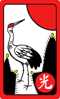
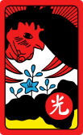
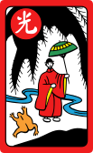

<div align="center">



# 고스톱 Trainer

Browser-based **Go-Stop (고스톱)** trainer with a rule-based AI opponent,  
animated scoring breakdowns, and full 🇩🇪 / 🇺🇸 / 🇰🇷 support.  
No backend. Runs entirely in the browser — installable as a PWA.

[](https://tscz.github.io/gostop)
[](https://github.com/tscz/gostop/actions/workflows/build.yml)
[](LICENSE)

</div>

---

## Features

- **Full game rules** — matching, go/stop decisions, all standard yaku
- **Animated score panel** — highlights 광박, 고박, 피박 and combo breakdowns
- **Session scoreboard** — tracks wins across multiple rounds
- **Special rules** — nagari (draw), 광쪽박, post-poktan skip
- **Loser penalties** — 광박 ×2, 고박 ×2, 피박 ×1 multipliers
- **Multilingual** — full EN / DE / KO translations, switchable in-app
- **PWA** — installable on Android; works offline after first visit

---

## Getting started

```bash
npm install
npm run dev
```

Open [http://localhost:5173/gostop/](http://localhost:5173/gostop/).  
Press **?** in the top-right corner for the in-app rules reference.

## Scripts

| Command | What it does |
|---|---|
| `npm run dev` | Start the Vite dev server |
| `npm run build` | Type-check + production build |
| `npm run preview` | Preview production build locally |
| `npm test` | Run unit tests (Vitest, 149 tests) |
| `node scripts/gen-icons.cjs` | Regenerate PWA icons from the hwatu SVG |

---

## Project structure

```
src/
├── core/           # Pure TypeScript game logic (no React)
├── store/          # Zustand global state
├── components/     # React UI components
├── i18n/           # Translations — de.json  en.json  ko.json
├── App.tsx
└── main.tsx
scripts/
└── gen-icons.cjs   # Renders PWA icons via headless Firefox + Playwright
public/
└── assets/cards/   # 48 hwatu SVGs (CC BY-SA 4.0, Marcus Richert)
```

---

## Deployment

Every push runs CI via `build.yml`.  
Publishing a **GitHub Release** triggers `deploy-release.yml`, which builds and deploys to the `gh-pages` branch automatically.

---

<div align="center">

Hwatu card artwork by **Marcus Richert**, based on Louie Mantia Jr.'s Hanafuda graphics.  
Licensed under [CC BY-SA 4.0](https://creativecommons.org/licenses/by-sa/4.0/).  
Source: [Wikimedia Commons – Category:SVG Hwatu](https://commons.wikimedia.org/wiki/Category:SVG_Hwatu)

</div>
